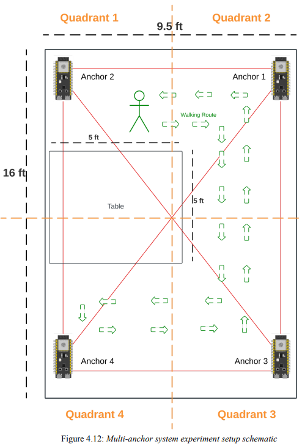
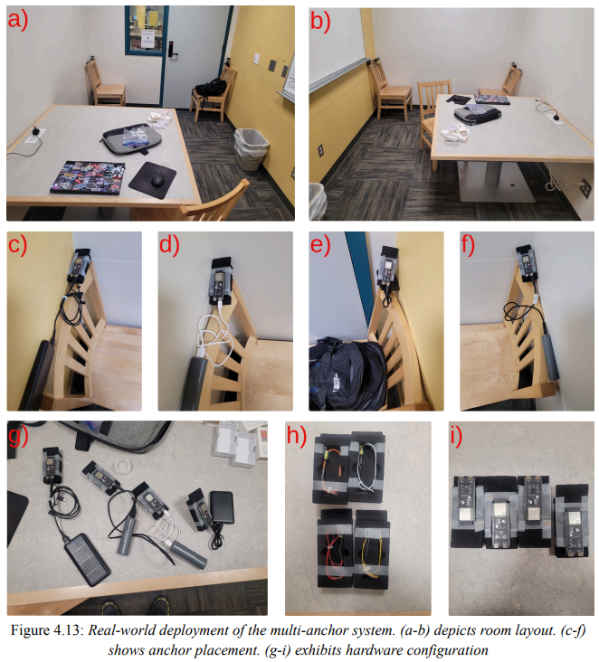
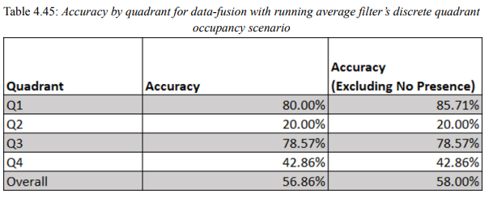
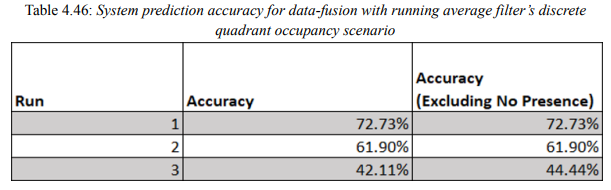
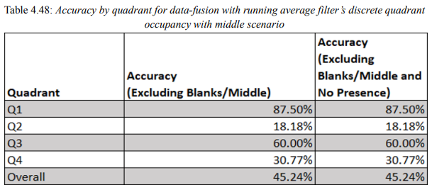
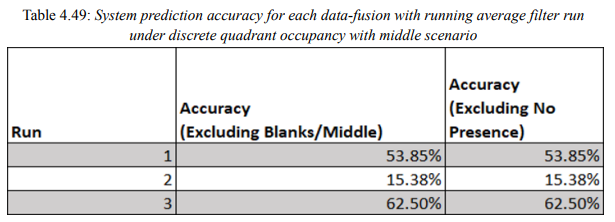

# Passive Zone-Based Human Localization in Indoor Environments Using BLE RSSI
Indoor localization systems have been explored to address GPS and cellular positioning limitations in enclosed environments, but these approaches usually require active user participation, hardware-based exploits, specialized hardware, or high computational demands. To resolve these challenges, this thesis presents a system composed of four BLE-emitting ESP32-S3 anchors and a central processing unit that leverages human RSSI attenuation to successfully perform passive localization of humans in indoor environments. The system was iteratively developed by observing the behavior of RSSI from individual variables and during multi-anchor deployment. This process led to several system design decisions and the development of a threshold-based heuristic algorithm for human localization. Upon implementing and optimizing the threshold-based heuristic with a data-fusion technique, the system achieved a 56.86% overall accuracy under discrete quadrant occupancy scenarios, a 45.24% overall accuracy under the quadrant with middle occupancy scenario, and displayed signs of general movement under the movement scenario. From this, a passive zone-based human localization system for indoor environments was produced.

## System Setup

## Results

## Main Findings

- Human presence can influence BLE RSSI measurements, providing a basis for passive, zone-based localization.
- RSSI behavior varied across links, with occlusion-sensitive links providing useful indications of human presence and occlusion-free links serving as supporting links for zone prediction.
- A threshold-based heuristic using data fusion and a running average filter achieved a peak overall accuracy of 56.86% for discrete quadrant occupancy and 45.24% for quadrant and center occupancy.
- The system demonstrated general movement indications but remained susceptible to RSSI variability and false predictions under unoccupancy scenarios.

## Documents

- [Thesis](thesis-documentation/JAZTIN_TABUNDA_THESIS_FINAL.pdf)
- [Presentation](thesis-documentation/JAZTIN_TABUNDA_THESIS_FINAL.pdf)

## Source Code

- `AnchorDriver/` – Code running on the ESP32-S3 anchors.
- `CentralUnitDriver/` – Central processing unit implementation.
